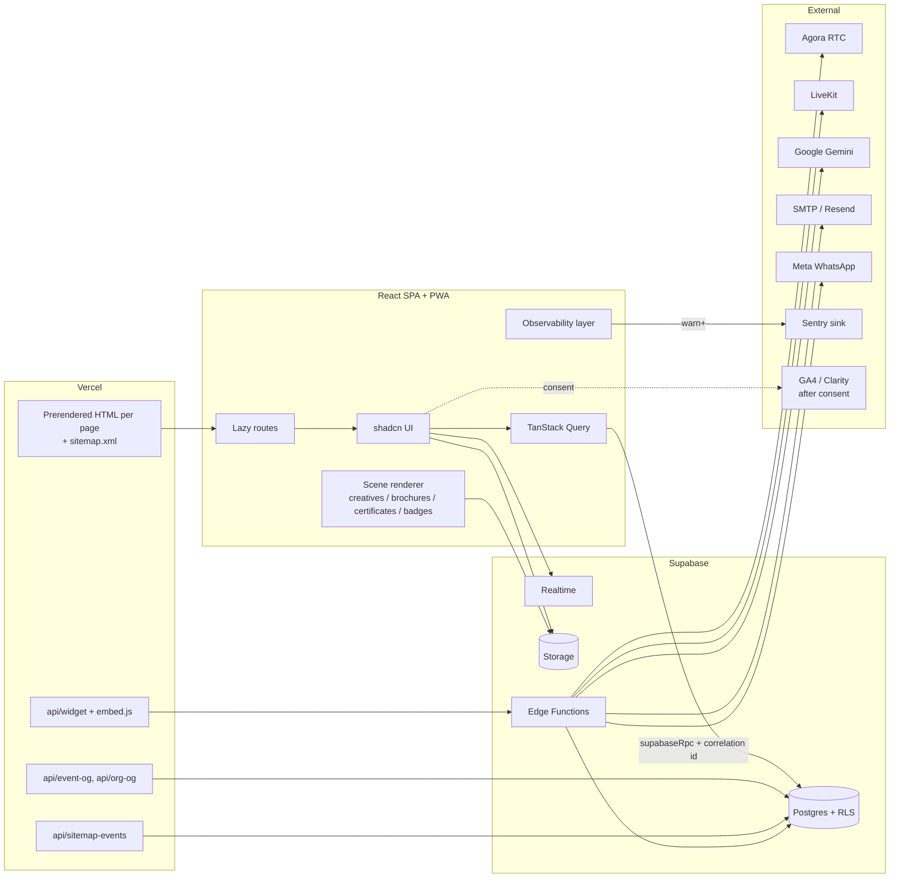

# illuxus

An all-in-one events platform. Organisers publish branded event pages, take registrations, check
guests in and out by QR code, print badges, run browser-based webinars, and design posters,
brochures and certificates. After the event, they keep attendees together in a community. The
codebase leans hard on observability, property-based tests, row-level security and honest
public pages.

> **New here?** Read [Project layout](#project-layout) and [Conventions](#conventions) first, then
> [`ROADMAP.md`](./ROADMAP.md) for direction and the product mindmap, and
> [`docs/COMPLIANCE.md`](./docs/COMPLIANCE.md) before touching anything legal, payments or
> messaging.

---

## Table of contents

- [Stack at a glance](#stack-at-a-glance)
- [Getting started](#getting-started)
- [High-level architecture](#high-level-architecture)
- [Project layout](#project-layout)
- [Route map](#route-map)
- [Data layer](#data-layer)
- [Features](#features)
- [SEO and public pages](#seo-and-public-pages)
- [Legal, privacy and accessibility](#legal-privacy-and-accessibility)
- [Security and observability](#security-and-observability)
- [Performance and scalability](#performance-and-scalability)
- [Testing](#testing)
- [Configuration](#configuration)
- [Conventions](#conventions)
- [Recent updates](#recent-updates)
- [Documentation index](#documentation-index)

---

## Stack at a glance

| Layer | Choice |
| --- | --- |
| Build / dev | Vite 5 + SWC, TypeScript 5, Bun (canonical package manager) |
| UI | React 18, Tailwind 3, shadcn/ui (Radix), Framer Motion, Sonner |
| Routing | `react-router-dom` v6, every route lazy-loaded through `lazyWithLog` |
| Data | Supabase Postgres (RLS on every table), Realtime, Storage, Edge Functions (Deno) |
| Server state | TanStack Query v5 |
| Forms | `react-hook-form` + `zod` |
| Live video | Agora (`agora-rtc-sdk-ng`), the main stage; LiveKit, the legacy stage |
| Canvas and print | Custom scene renderer for creatives, `jspdf` / `jspdf-autotable` for PDFs, `exceljs`, `qrcode.react`, `html5-qrcode` |
| AI | Google Gemini via edge functions (creative copy and backgrounds), with per-event daily quotas |
| Hosting | Vercel: static SPA, per-page prerendered HTML, Edge functions under `api/` |
| Email / messaging | SMTP (Gmail or Resend), Meta WhatsApp Cloud API |
| Observability | Internal Logger + `supabaseRpc` wrapper, Sentry-compatible remote sink, error boundaries |
| Tests | Vitest, fast-check (property-based), Testing Library, Playwright (e2e and visual) |
| PWA | `vite-plugin-pwa` (Workbox), installable on iOS, Android and desktop |

Exact versions live in `bun.lock`.

---

## Getting started

```sh
bun install
cp .env.example .env.local   # fill in Supabase and, optionally, analytics values
bun run dev
```

| Script | Purpose |
| --- | --- |
| `bun run dev` | Vite dev server |
| `bun run build` | Production build, plus prerendered per-page HTML and `sitemap.xml` (see [SEO](#seo-and-public-pages)) |
| `bun run build:dev` | Development-mode build |
| `bun run preview` | Serve the production build locally |
| `bun run lint` | ESLint |
| `bun run test` | Vitest, single run (unit and property tests) |
| `bun run test:watch` | Vitest in watch mode |
| `bun run audit:tokens` | Design-token audit of the QuickView surfaces |

`package-lock.json` exists for npm fallback; ignore any stray `pnpm-*` files.

Dev-only preview routes: `/__preview/creatives` shows every creative template in every format,
and `/__preview/quick-views` shows the quick-view panels.

---

## High-level architecture



### Key principles

1. **Every RPC goes through `supabaseRpc`** (`@/lib/observability`). It adds a correlation id, logs duration and threads errors into the Logger. Lint enforces it.
2. **Every log line goes through `logger`.** `no-console` is an error; the one sanctioned exception is the contractual `console.warn('UI sync failure')` in `RegistrationsSection.tsx`.
3. **Routes are lazy** via `lazyWithLog(...)`, so chunk-load failures reach the Logger before the route error boundary.
4. **Gates wrap authenticated routes:** `AuthProvider` → `OrgProvider` → `ProfileGate` → an organiser, admin or attendee gate.
5. **Public URLs come from `publicOrigin()`** (`src/lib/publicUrl.ts`). Never inline a host.
6. **Public copy must match the code.** Don't advertise a feature, integration or certification that doesn't exist. [`docs/COMPLIANCE.md`](./docs/COMPLIANCE.md) lists the claims still waiting on code.

---

## Project layout

```
src/
├── App.tsx                     route table, gates, GlobalFooter, cookie banner
├── main.tsx                    entrypoint: boots the Logger, mounts <App/>
├── components/
│   ├── ui/                     shadcn primitives (wrap, don't edit)
│   ├── landing/                landing sections, motion, PlatformModules
│   ├── layout/                 SiteContainer, PublicPageShell, Breadcrumbs, portal shell
│   ├── event/                  event workspace: registrations, attendance, sessions,
│   │                           speakers, sponsors, venue, reports, utm, page-form,
│   │                           page-builder, creatives, brochure, certificates
│   ├── community/              feed, comments, chat, notifications
│   ├── webinar/                Agora stage, LiveKit stage, lobby, controls
│   ├── applications/           speaker / sponsor application dialogs
│   ├── auth/                   password meter, 2FA challenge
│   ├── CookieConsent.tsx       consent banner (GPC-aware)
│   ├── ConsentCheckbox.tsx     required, unticked form consent
│   ├── RouteSeo.tsx            per-page title, description, canonical, JSON-LD
│   └── SiteHead.tsx            site-wide defaults, organisation schema, analytics after consent
├── pages/
│   ├── Index, Features, Pricing, About, Contact, Faqs, Documentation
│   ├── Privacy, Terms, CookiePolicy, RefundPolicy, Gdpr, Accessibility, DataDeletion
│   ├── DiscoverFeed, EventsListingPage, PublicEventPage, PublicOrgPage, EventLivePage
│   ├── SelfCheckIn/Out, CertificateVerify, TicketTrack, MyTickets, ActivateAccount, InviteAccept
│   ├── seo/                    keyword landing pages
│   ├── u/  t/                  attendee profile, events, applications, communities; ticket detail
│   ├── speaker/ sponsor/       portals
│   ├── partner/                partner analytics portal (UTM shares)
│   ├── dashboard/              organiser workspace
│   │   ├── event/              broadcast, guest list, creatives, brochure, certificates, UTM
│   │   ├── community/          per-community pages
│   │   └── admin/              super-admin pages
│   └── dev/                    dev-only previews
├── contexts/                   Auth, Org, Theme
├── hooks/                      app-wide hooks (+ community/*)
├── lib/
│   ├── observability/          logger, sinks, redaction, correlation, offline queue, boundaries
│   ├── attendance/             pure check-in/out state machine + 13 property tests
│   ├── creatives/studio/       scene graph, templates, formats, renderer
│   ├── brochure/               sections, templates, PDF, inline editor
│   ├── certificates/           designs, fields, PDF, issuing API
│   ├── seo/                    build-time prerender + sitemap builders
│   ├── utm/                    attribution capture and storage
│   ├── data-export.ts          "Download my data"
│   ├── data-deletion.ts        deletion-request tickets
│   ├── image-loader.ts         canvas image loading with a CORS fallback
│   ├── print-badges.ts, badge-*.ts, fit-engine.ts
│   ├── currency.ts, fx.ts, datetime.ts, timezones.ts, ics.ts
│   └── publicUrl.ts, event-routes.ts, safe-redirect.ts, sanitize-html.ts
├── integrations/supabase/      generated types + browser client
└── types/

api/                            Vercel Edge functions: event-og, org-og, sitemap-events, widget, geo
supabase/
├── migrations/                 000_full_schema.sql (base schema + ordered migration sections)
├── functions/                  Deno edge functions (see Data layer)
└── config.toml
docs/                           compliance, audits, observability, setup guides
tests/                          Playwright e2e + visual regression
scripts/                        token audit, slug check
```

---

## Route map

### Public and marketing

- `/` — landing page (signed-in users go to `/discover`)
- `/discover`, `/events`, `/events/:id`, `/e/:id`
- `/org/:slug`, `/org/:orgSlug/events/:eventSlug` (canonical event URL)
- `/o/:slug`, `/o/:orgSlug/:eventSlug` — legacy; permanently redirected to `/org/…`
- `/features`, `/pricing`, `/about`, `/contact`, `/faqs`, `/docs`
- `/event-management-software`, `/event-ticketing-platform`, `/conference-management-platform`, `/webinar-platform-india`
- `/certificates/:code` — public certificate verification
- `/support/ticket/:ticketNumber` — support ticket tracking
- Unknown paths show the custom 404 page (`noindex`)

### Legal and privacy

- `/privacy`, `/terms`, `/cookies`, `/refunds` (`/refund-policy` redirects here), `/gdpr`, `/accessibility`, `/data-deletion`

### Auth and onboarding

- `/login`, `/reset-password`, `/activate`, `/invite`, `/complete-profile`, `/onboarding`

### Attendee

- `/u/me` (profile, followed organisations, **Download my data**), `/u/me/events`, `/u/me/applications`, `/u/me/communities`, `/u/me/settings`
- `/my/tickets`, `/t/:id`
- `/checkin/:eventId`, `/checkout/:eventId` — self check-in and self check-out
- `/e/:id/live` — live event (optional `?join=` personal link)

### Organiser workspace (`OrganizerRoute` + `OnboardingGuard`)

- `/dashboard`, `/dashboard/events`, `/dashboard/events/new`
- `/dashboard/events/:id` — tabs: Overview, Website, Design, Agenda, Speakers, Sponsors, Venue, Registrations, Attendees, Communicate, Webinar, Community, Creatives, Brochure, Certificates, UTM / Links, Reports, Settings
- `/dashboard/events/:id/guests`, `/dashboard/events/:id/broadcast`
- `/dashboard/tickets`, `/dashboard/reports`, `/dashboard/analytics`, `/dashboard/marketing`, `/dashboard/landing-builder`, `/dashboard/organization`, `/dashboard/billing`, `/dashboard/help`, `/dashboard/settings`

### Community

- `/community`, `/community/:slug` and `/feed`, `/members`, `/announcements`, `/calendar`, `/resources`, `/chat`, `/communications`, `/moderation`, `/settings` under it
- `/dashboard/community/*` for organisers

### Portals

- Speaker: `/speaker`, `/speaker/events/:eventId`
- Sponsor: `/sponsor`, `/sponsor/events/:eventId`, `/sponsor/accept`
- Partner: `/partner`, `/partner/:accessId` (UTM analytics shared without an account)

### Super-admin

- `/dashboard/admin` and `/site`, `/audit`, `/analytics`, `/tickets`, `/users`, `/organizations`, `/plans`, `/events`, `/revenue`, `/system`, `/activity`

Permanent (301) redirects for old and alternative URLs live in `vercel.json` → `redirects`.

---

## Data layer

`supabase/migrations/000_full_schema.sql` is the single SQL bundle. It contains the base schema
followed by the ordered migration sections; each section keeps its original filename as a marker.
Run the whole file once only when provisioning a fresh database. For an existing database, apply
only the relevant section after checking its prerequisites; do not replay the bundle or use it as a
replacement for the existing Supabase migration history. Regenerate
`src/integrations/supabase/types.ts` after a schema change, and never edit it by hand.

> The generated types are currently behind the schema. `tsc` reports errors in pages that use
> newer tables (for example `event_emails`, `video_provider`). Regenerate them before relying on
> type checking for those files.

### Main tables

| Area | Tables |
| --- | --- |
| Events | `events` (incl. `page_config`), `sessions`, `session_speakers`, `event_speakers`, `event_sponsors`, `org_sponsor_tiers`, `event_venue_selections` |
| People | `profiles`, `user_roles`, `speakers`, `sponsors`, `sponsor_members`, `speaker_applications`, `sponsor_applications` |
| Registrations | `registrations` (QR code, approval status, attendance state), `attendance_events` (immutable audit trail) |
| Organisations | `organizations`, `org_members`, `org_invitations`, `org_followers`, `brand_kits`, `subscriptions` |
| Design | `event_creatives`, `event_creative_backgrounds`, `event_creative_ai_drafts`, `certificate_templates`, `certificate_template_versions`, `certificates`, `certificate_audit` |
| Messaging | `communications`, `communication_recipients`, `event_emails`, `email_settings`, `app_notifications` |
| Attribution | `utm_links`, `utm_clicks`, `utm_partner_access` |
| Community | `community_*` (members, posts, comments, reactions, messages, polls, badges, connections, reports) |
| Webinar | `webinar_*` (sessions, attendance, chat, Q&A, polls, reactions, stage requests, speakers) |
| Plans | `plans` (features and limits per plan), `organizations.plan`, `organizations.feature_overrides`, `subscriptions` |
| Platform | `site_content` (site editor), `audit_logs`, `support_tickets`, `support_ticket_messages`, `cities` |

### Edge functions (`supabase/functions/`)

| Group | Functions |
| --- | --- |
| Video | `agora-token`, `livekit-token`, `livekit-room-create`, `livekit-room-end`, `livekit-go-live`, `livekit-promote`, `livekit-webhook`, `recording-start`, `recording-stop` |
| Email | `send-email`, `send-event-email`, `send-communication-email`, `send-ticket-email`, `send-ticket-reply`, `send-speaker-invite-email`, `send-sponsor-invite-email`, `team-invitation` |
| WhatsApp | `send-whatsapp`, `whatsapp-sync-templates`, `whatsapp-webhook` (HMAC-verified) |
| Registration | `guest-registration` (register without an account), `create-participant-account` |
| Venue | `notify-venue-selection`, `notify-organizer-venue-response` |
| AI | `generate-creative-copy`, `generate-creative-background` (Gemini, quota-limited) |
| Support | `submit-support-ticket` (also used for data-deletion requests) |
| Other | `fx-rates`, `org-events` (widget feed), `og-event`, `seed-cities` |

Shared helpers live in `_shared/`: CORS allowlist, auth, plan checks (`entitlements.ts`), SMTP, Resend and the edge logger.

### Vercel Edge functions (`api/`)

| Route | Purpose |
| --- | --- |
| `api/event-og`, `api/org-og` | Server-rendered Open Graph tags for event and organisation pages |
| `/sitemap-events.xml` → `api/sitemap-events` | Live sitemap of published events and organisation pages |
| `api/widget` + `/embed.js` | Embeddable "upcoming events" widget, with no Supabase keys in the snippet |
| `api/geo` | Country lookup for the phone-code picker |

---

## Features

### Event workspace

- **Event creation:** quick create, slug generation with collision retry, drafts.
- **Event website:** a page builder with themes, title and body size sliders, a 1128 × 191 cover banner, and sections for agenda, speakers, sponsors, venue and FAQs.
- **Agenda:** multi-day sessions in the event's own time zone, with speakers attached.
- **Speakers and sponsors:** management, applications, self-serve portals, sponsor tiers, and logo and photo uploads.
- **Venue sourcing:** a venue marketplace picker, service requests and venue responses with email notifications.
- **Registrations:**
  - Ticket categories, approval queue, waitlist, bulk import and invitations.
  - Guest registration without an account, with a password set afterwards.
  - Email de-duplication across roles, inline role change, quick-view panels, per-attendee tracked join links.
- **Check-in and check-out:** separate scanner modes over a property-tested state machine, a self check-in kiosk and live attendance.
- **Badges:** a badge designer, banner layouts, thermal-printer fitting, printing, and bulk download as PDF or JPG from the Registrations toolbar.
- **Communicate:** email broadcasts with per-recipient delivery status, WhatsApp templates and announcements.
- **Reports:** CSV, Excel and PDF exports, with column selection.

### Design studio

- **Creative studio:** a Canva-style scene editor. Every element can be moved, resized, restyled or removed.
  - 48 designs per creative type, with colourways and event and partner versions.
  - Every social format, built from the event's own speakers, sponsors and branding.
  - AI-drafted copy and backgrounds, and PNG or ZIP export.
- **Brochure builder:** several brochure types, including a full-page poster cover and the DevOps Connect reference format.
  - Section reordering and colour schemes.
  - Inline editing of every element, with autosave.
  - PDF export.
- **Certificates:** a template studio, bulk issuing, PDF output and public verification at `/certificates/:code`.

### Live and community

- **Webinars:** an Agora stage with chat, Q&A, polls, reactions, stage requests, a waiting lobby, pre-join checks, branding and recording. LiveKit is the legacy stage.
- **Communities:** feed, comments, announcements, calendar, resources, chat, members, leaderboard, moderation and content reports.

### Growth and analytics

- **UTM and partners:** tracked links, click and registration attribution, lead exports, and partner dashboards shared by link.
- **Analytics:** organiser KPIs and charts, and platform analytics for admins.
- **Website widget:** one `<script>` tag shows an organisation's upcoming events on any site.
- **SEO landing pages and the discovery feed.**

### Organisation and platform

- **Organisations:** multiple workspaces, team invitations (verified inviters, personal details only), brand kit, organisation landing page, custom domains.
- **Accounts:** emailed sign-up code, 2FA, and a country-code picker pre-selected from the visitor's IP.
- **Super-admin:** site editor (draft and publish), users, organisations, plans and features, event moderation, revenue, system health, activity and audit logs, support tickets.

### Plans and feature access

Super admins decide which organiser features each plan includes, at `/dashboard/admin/plans`: one column per plan, one row per feature, plus each plan's limits. They can also switch single features on or off for one organisation (Organizations → open an organisation → Features).

- **Catalogue:** `src/lib/plans/features.ts` lists every feature: the event workspace sections (website, agenda, speakers, sponsors, venue sourcing, badges, self check-in kiosk, email broadcasts, WhatsApp, webinar studio, communities, creative studio, AI copy and backgrounds, brochures, certificates, UTM links, reports) and organisation-level ones (marketing, landing page). Perks marked "Label only" are shown on the plan but not checked anywhere yet.
- **Source of truth:** the database. The `plans` table holds each plan's features, and `org_entitlements(org)` returns what an organisation gets: plan features + legacy `addons` + overrides set to on − overrides set to off.
- **App:** event sections that aren't on the plan show a lock and an upgrade panel (`FeatureGate`), checked against the event's own organisation. "Request access" files a billing support ticket. Super admins can always open everything.
- **Server:** triggers refuse new certificates, certificate templates, creatives, UTM links and venue selections when the plan lacks them. Edge functions refuse webinar tokens and rooms, AI generation, WhatsApp sends and email broadcasts the same way.
- **Plan changes:** only super admins can change an organisation's plan, add-ons or overrides. New workspaces always start on Free, and a paid plan picked during onboarding becomes an upgrade request.
- **Limits:** limits (events, attendees, team members) are stored and shown but not enforced yet.
- **Before first use:** run the `048_plan_features.sql` section of `000_full_schema.sql`. Until then the app falls back to the built-in plans, which keep every module on (the webinar studio stays an add-on).
- **PWA:** installable, offline app shell, update prompt, safe-area support.

> **Not built yet, though some copy mentions them:** payment collection (Razorpay / Stripe), SSO,
> AI matchmaking, promo codes and offline scan queueing. See
> [`docs/COMPLIANCE.md`](./docs/COMPLIANCE.md) §2.

---

## SEO and public pages

The app is a single-page app, so `vite.config.ts` adds a `seoPrerender` plugin. At build time it
reads every page's `<RouteSeo title description canonical>` and does the following:

- writes `dist/<path>/index.html` with that page's own title, description, canonical URL, Open Graph and Twitter tags, breadcrumb JSON-LD and a `<noscript>` summary with internal links;
- writes `dist/sitemap.xml` and `dist/sitemap-index.xml`. The index points at the static sitemap and at the live `/sitemap-events.xml`.

Pages with run-time values (events, organisations) or `noindex` are skipped. Event and organisation
pages get their tags from `api/event-og` and `api/org-og`. `src/lib/seo/__tests__/prerender.test.ts`
checks that every prerendered page has a unique path, title and description, and that each
description is at least 50 characters.

Also in place:

- `public/robots.txt`;
- 301 redirects in `vercel.json`;
- a site-wide organisation and website schema (`SiteHead.tsx`);
- visible breadcrumbs on public pages;
- a custom 404 page;
- `loading="lazy" decoding="async"` on images;
- Search Console and Bing verification tags, read from env vars.

---

## Legal, privacy and accessibility

| Surface | Where |
| --- | --- |
| Privacy Policy (DPDPA 2023, IT Act, SPDI Rules, IT Rules 2021, CERT-In) | `/privacy` |
| Terms of Service | `/terms` |
| Cookie Policy | `/cookies` |
| Refund & Cancellation Policy | `/refunds` |
| GDPR Notice (EU / UK) | `/gdpr` |
| Accessibility Statement (WCAG 2.2 AA, partial) | `/accessibility` |
| Data deletion and marketing opt-out requests | `/data-deletion` (filed as a privacy support ticket) |
| Download my data (JSON) | `/u/me` → "Your data" |
| Cookie banner | `CookieConsent.tsx`: nothing non-essential by default, an equal "Reject" button, reopened from "Cookie settings" in the footer, Global Privacy Control honoured |
| Form consents | `ConsentCheckbox.tsx`: required and never pre-ticked; Terms acceptance stored as `terms_accepted_at` |
| Keyboard access | skip link, visible focus ring, reduced-motion support |

The full law-by-law review and the open gaps are in [`docs/COMPLIANCE.md`](./docs/COMPLIANCE.md).
Update it whenever a legal page, sub-processor or market changes.

---

## Security and observability

**Security controls**

- Row-level security on every table; `SECURITY DEFINER` functions pin `search_path`.
- An origin allowlist (`ALLOWED_ORIGINS`) on edge functions, and rate limits on public ones (guest registration, invitations, email, AI generation).
- HMAC verification on the WhatsApp webhook.
- Hardening on 9 October 2026: open email relay, account-takeover paths and data-exposure holes closed (migration `038_security_hardening.sql`).
- HSTS (preload), `X-Frame-Options: DENY`, `nosniff`, `Referrer-Policy`, and a `Permissions-Policy` that allows only the camera and microphone.
- PII redaction in all logs.
- Still open: a Content-Security-Policy header, and 180-day log retention for CERT-In (see `docs/COMPLIANCE.md`).

**Observability** (`src/lib/observability/`)

The structured Logger supports levels, correlation ids, PII redaction, an IndexedDB offline queue,
route and root error boundaries, a Sentry-compatible remote sink, and opt-out at build time or run
time.

```ts
import { logger, supabaseRpc } from '@/lib/observability';

logger.info('clicked rsvp', { event_id });
const { data, error, correlationId } = await supabaseRpc('set_attendance', { p_reg_id });
```

See [`docs/observability.md`](./docs/observability.md) and
[`docs/observability-privacy.md`](./docs/observability-privacy.md).

---

## Performance and scalability

Capacity estimates (from the 27 August 2026 audit):

| Surface | Comfortable | Stress point | First failure mode |
| --- | --- | --- | --- |
| Anonymous landing (Vercel CDN) | ~50,000 RPS | 100,000 RPS | Vercel / Edge quota |
| Authenticated API (Supabase Pro) | ~1,500 RPS | 4,000 RPS | RLS CPU |
| Realtime connections (Supabase Pro) | 500 | 1,000 | Realtime quota |
| One live event page | ~500 attendees | ~1,000 | WAL volume |
| Agora / LiveKit video | 3,000 viewers per room | 10,000 | Bandwidth and licence tier |

Details and remediation: [`docs/PLATFORM_AUDIT.md`](./docs/PLATFORM_AUDIT.md).

**Optimisations:**

- route-level code splitting, with heavy libraries (ExcelJS, jsPDF, Agora) loaded lazily;
- TanStack Query defaults (`staleTime` 30 s, `gcTime` 5 min, no refetch on focus);
- Workbox caching: the app shell is precached, Storage is cache-first and the REST API is network-first;
- prerendered HTML for public pages, and lazy-loaded images;
- server-side pagination for large lists.

---

## Testing

| Suite | Command | Covers |
| --- | --- | --- |
| Unit + property | `bun run test` | `src/**/__tests__/*.test.ts(x)`, `*.pbt.test.ts` (fast-check) |
| E2E | `npx playwright test` | `tests/e2e/*.spec.ts`, `tests/badge-fit.spec.ts` |
| Visual regression | `npx playwright test tests/visual` | QuickView surfaces |

Property tests cover:

- the attendance state machine (13 files);
- the badge fit engine;
- sanitisation and redaction;
- template resolution;
- UTM attribution, including a SHA-256 "tripwire" on attendee-facing files that fails when those files change without a re-audit.

**Known red tests (20 Oct 2026):**

- The UTM tripwire for `RegistrationsSection.tsx` and `RegistrantQuickView.tsx`: those files changed upstream and need re-auditing, then new fingerprints.
- `gutters.test.tsx`: `SiteHeader` no longer uses `SiteContainer` after the navbar rewrite.

---

## Configuration

### Client (Vite) variables

| Variable | Purpose | Default |
| --- | --- | --- |
| `VITE_SUPABASE_URL`, `VITE_SUPABASE_PUBLISHABLE_KEY`, `VITE_SUPABASE_PROJECT_ID` | Supabase project | — |
| `VITE_PUBLIC_ORIGIN` | Origin used in share links and auth emails | `https://illuxus.com` |
| `VITE_PUBLIC_PUBLISHED_HOST`, `VITE_PUBLIC_DOMAIN` | Published-event host and apex domain | `events.illuxus.com`, `illuxus.com` |
| `VITE_WEBINAR_PROVIDER`, `VITE_AGORA_APP_ID` | Webinar stage selection | — |
| `VITE_OBSERVABILITY_DSN`, `VITE_OBSERVABILITY_OPT_OUT` | Remote error sink | — |
| `VITE_GA4_ID`, `VITE_CLARITY_ID` | Analytics, loaded only after cookie consent | — |
| `VITE_GSC_VERIFICATION`, `VITE_BING_VERIFICATION` | Search Console and Bing verification tags, written into prerendered HTML | — |
| `VITE_BUILD_SHA` | Commit sha, injected at build | — |

### Edge-function secrets (Supabase)

| Area | Secrets |
| --- | --- |
| Core | `SUPABASE_URL`, `SUPABASE_ANON_KEY`, `SUPABASE_SERVICE_ROLE_KEY`, `ALLOWED_ORIGINS` |
| Email | `SMTP_HOST`, `SMTP_PORT`, `SMTP_USERNAME`, `SMTP_PASSWORD`, `SMTP_FROM`, `RESEND_FROM`, `RESEND_FROM_EMAIL`, `SUPPORT_EMAIL`, `SUPPORT_INBOX_EMAIL` |
| Video | `AGORA_APP_ID`, `AGORA_APP_CERTIFICATE`, `LIVEKIT_API_KEY`, `LIVEKIT_API_SECRET`, `LIVEKIT_WS_URL` |
| WhatsApp | `WHATSAPP_TOKEN`, `WHATSAPP_PHONE_NUMBER_ID`, `WHATSAPP_BUSINESS_ACCOUNT_ID`, `WHATSAPP_APP_SECRET`, `WHATSAPP_VERIFY_TOKEN`, `WHATSAPP_API_VERSION` |
| AI | `GEMINI_API_KEY`, `GEMINI_COPY_MODEL`, `GEMINI_COPY_DAILY_QUOTA`, `GEMINI_PER_EVENT_DAILY_QUOTA` |
| Links | `PUBLIC_DOMAIN`, `PUBLIC_PUBLISHED_HOST`, `ORGANIZER_DASHBOARD_URL`, `VENDOR_PORTAL_URL` |

Source-map upload in CI needs `OBSERVABILITY_AUTH_TOKEN`, `OBSERVABILITY_ORG` and
`OBSERVABILITY_PROJECT`. Setup guides: [`docs/agora-setup.md`](./docs/agora-setup.md),
[`docs/gemini-setup.md`](./docs/gemini-setup.md).

---

## Conventions

- **Money** uses `formatMoney` from `@/lib/currency`. Amounts are stored in the event's currency; `useFxRates` (5-minute TTL) converts for display.
- **Datetimes** are stored in UTC and shown in event-local time via `@/lib/datetime`. Never call `new Date(iso).getDate()` on a stored timestamp; that is how the "Day 2" agenda bug happens.
- **URLs** for organisations and events come from `event-routes.ts`; share links come from `publicOrigin()`.
- **shadcn primitives** in `components/ui/` are generated. Wrap them; don't edit them.
- **Colours** are CSS-variable tokens (`bg-card`, `text-foreground`, …). A new colour means a new token, not a hex value.
- **Person titles** are one of `Mr`, `Ms`, `Mrs`, `Prefer not to say` (a DB trigger validates this); see `TITLE_OPTIONS` in `src/lib/phone-country.ts`.
- **The footer is global** (`<GlobalFooter />` in `App.tsx`). Don't add a footer per page.
- **Every public page** declares `<RouteSeo>` with a unique title, a description of 50+ characters and a canonical URL. The prerender tests enforce this.
- **Consent checkboxes** use `ConsentCheckbox`, are never pre-ticked, and link to the documents they cover.
- **Canvas images** load through `loadCanvasImage` (`src/lib/image-loader.ts`) so exports don't break on CORS.
- **Write property tests first** wherever behaviour has an invariant (state machines, idempotence, ordering, redaction).

---

## Recent updates

### October 2026

- **Compliance pass:**
  - Global Privacy Control honoured, "Download my data" on `/u/me`, and an accessibility statement at `/accessibility`.
  - Privacy-policy references corrected, and a global compliance review in [`docs/COMPLIANCE.md`](./docs/COMPLIANCE.md).
- **Landing page:** honest feature cards, plus a new "One workspace for the whole event" section covering the creative studio, brochures, certificates, communities, venue sourcing, partner links, the widget and the installable app.
- **SEO:**
  - Per-page prerendered HTML, a live events sitemap, 19 permanent redirects and unique page tags.
  - Breadcrumbs, a custom 404 page, lazy-loaded images, env-driven verification tags, and FAQ structured data on the home page.
- **Legal:** Refund Policy, Cookie Policy rewrite, data-deletion requests, required form consents, an honest cookie banner, and the fake reviews removed.
- **Certificates:** template studio, issuing and public verification.
- **Creative studio:** a data-driven, Canva-style studio with 48 designs per type, colourways, event and partner versions, and every element editable.
- **Brochures:** several brochure types, a full-page poster cover, inline editing with autosave, and a fix for images not loading.
- **Badges:** bulk download from Registrations, PDF or JPG output, banner layouts, saved band colours and the fit engine.
- **Registration and teams:**
  - Registration without an account, an emailed sign-up code, and a single country-code picker.
  - Verified team invitations, and an organisation page with brand kit.
- **UTM:** tracked-link management, lead exports, and partner dashboards shared by link.
- **Security:** open email relay, account-takeover and data-exposure holes closed.
- **UI:** new portal shell, navbar and dashboard layout; smooth scrolling without scrollbars.

### September 2026

- Venue-scoped email notifications; badge fit engine and thermal-printer centring.

### August 2026

- Platform, security and QA audits ([`docs/PLATFORM_AUDIT.md`](./docs/PLATFORM_AUDIT.md), [`docs/SECURITY_AUDIT_2026-08-27.md`](./docs/SECURITY_AUDIT_2026-08-27.md)).

### July 2026

- PWA, schema consolidation, a mobile pass down to 375 px, and theme size sliders.
- Footer unification and Agora stage phase 1.
- Per-attendee UTM links, an admin panel, and timezone fixes.

---

## Documentation index

| Document | What it covers |
| --- | --- |
| [`ROADMAP.md`](./ROADMAP.md) | Product mindmap, Now / Next / Later, epics |
| [`docs/COMPLIANCE.md`](./docs/COMPLIANCE.md) | Global IT and data-protection review, open gaps, action plan |
| [`docs/PLATFORM_AUDIT.md`](./docs/PLATFORM_AUDIT.md) | Scalability, code quality and dependency audit |
| [`docs/SECURITY_AUDIT_2026-08-27.md`](./docs/SECURITY_AUDIT_2026-08-27.md) | Security, QA and reliability audit |
| [`docs/observability.md`](./docs/observability.md), [`docs/observability-privacy.md`](./docs/observability-privacy.md) | Logger, sinks, redaction, opt-out |
| [`docs/utm-attribution.md`](./docs/utm-attribution.md) | UTM capture, storage and the tripwire |
| [`docs/agora-setup.md`](./docs/agora-setup.md), [`docs/gemini-setup.md`](./docs/gemini-setup.md) | Third-party setup |

Public links must keep working: legacy `/o/…` URLs and the other old paths in `vercel.json` are
permanently redirected, never dropped.
