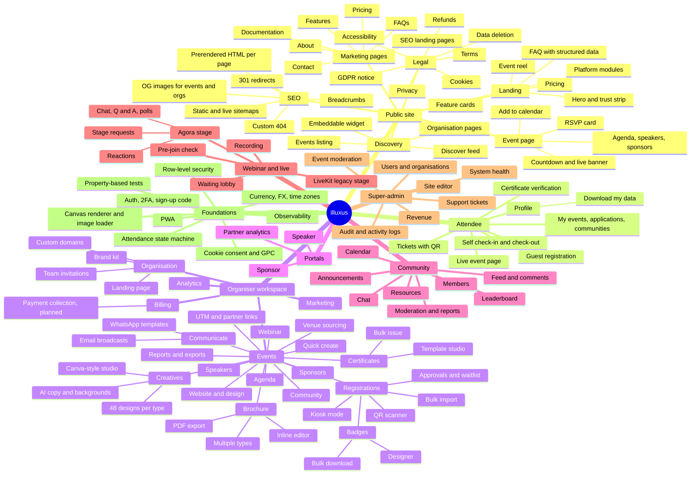

# illuxus roadmap

A living map of where the product is and where it is going. Use it when planning work or
deciding what to build next.

> Three lenses: a **mindmap** of the product surface, a **Now / Next / Later** timeline, and
> **epics** that tie goals to code paths. Last updated **20 October 2026**.

---

## 1. Product mindmap

Items marked *planned* are not built yet. Everything else is live in `main`.

---

## 2. Now / Next / Later

### Recently shipped (September – October 2026)

- **Compliance pass (20 Oct):**
  - Global Privacy Control honoured, "Download my data" on `/u/me`, and an accessibility statement at `/accessibility`.
  - Privacy-policy references corrected, and the footer GDPR link fixed.
  - A global law-by-law review in [`docs/COMPLIANCE.md`](./docs/COMPLIANCE.md).
- **Landing page:** feature cards now describe only shipped features, and a new "One workspace for the whole event" section shows the creative studio, brochures, certificates, communities, venue sourcing, partner links, the widget and the installable app.
- **SEO overhaul:**
  - Per-page prerendered HTML via the `seoPrerender` Vite plugin, a live `/sitemap-events.xml` and 19 permanent redirects.
  - Unique titles and descriptions on every public page, breadcrumbs, a custom 404, lazy-loaded images, env-driven Search Console and Bing verification, and home-page FAQ structured data.
- **Legal and consent:**
  - Refund Policy, data-deletion requests (filed as privacy tickets), and required, unticked form consents.
  - An honest cookie banner with an equal "Reject" button that can be reopened from the footer.
  - Fake reviews removed, plus keyboard navigation (skip link and focus rings).
- **Certificates:** template studio, bulk issuing, and public verification at `/certificates/:code`.
- **Creative studio rebuild:**
  - A data-driven, Canva-style scene editor with 48 designs per type, colourways, and event and partner versions.
  - Every element is editable, and AI drafts copy and backgrounds.
- **Brochure studio:**
  - Several types matching the DevOps Connect reference, including a full-page poster cover.
  - Inline editing of every element with autosave, and a fix for canvas images not loading.
- **Badges:** bulk download from the Registrations toolbar, PDF or JPG output, banner layouts, saved band colours, and the fit engine with thermal-printer centring.
- **Registration and teams:**
  - Registration without an account, an emailed 8-digit sign-up code, and one country-code picker everywhere.
  - Verified team invitations, and an organisation page with brand kit.
- **UTM and partners:** tracked-link CRUD, lead exports, and partner dashboards shared by link.
- **Security hardening (9 Oct):** open email relay, account-takeover and data-exposure holes closed.
- **Venue sourcing:** a marketplace picker, service requests and venue notifications.
- **New portal shell:** sidebar, navbar and dashboard layout.

Earlier milestones (PWA, schema consolidation, mobile pass, Agora phase 1, admin panel, timezone
fixes) are listed in the README's [Recent updates](./README.md#recent-updates).

### Now (in flight)

| Initiative | Status | Code area |
| --- | --- | --- |
| **Compliance blockers** | Review done; critical items need decisions (payments, named officers, unsupported claims) | `docs/COMPLIANCE.md`, legal pages, `src/pages/Index.tsx` |
| Observability phase F | Phases A–E shipped; production DSN and canary rollout pending | `src/lib/observability/` |
| Agora migration | Phase 1 shipped; recording and edge-function parity with LiveKit in progress | `src/components/webinar/`, edge functions |
| Test-suite health | 4 red tests: UTM tripwire re-audit, header gutter test | `src/lib/utm/__tests__/`, `src/components/layout/__tests__/` |
| Generated DB types | Behind the schema; `tsc` errors in pages that use newer tables | `src/integrations/supabase/types.ts` |

### Next (scoped follow-ups)

Write up requirements before starting anything bigger than a day.

1. **Payments.** Razorpay (INR, UPI) and Stripe (cards); approve paid registrations from the payment webhook; GST invoices; refunds through the gateway. Until it ships, block or relabel paid registrations (COMPLIANCE C1).
2. **Messaging compliance.** A suppression list, signed unsubscribe links and `List-Unsubscribe` headers on broadcasts, a postal address in the footer, and WhatsApp opt-in captured at registration (COMPLIANCE H1, H2).
3. **Consent records and age confirmation.** A `consent_records` table written at sign-up, registration and cookie choice; an 18+ confirmation or a guardian flow (COMPLIANCE H3, H4).
4. **Security headers and logs.** A report-only CSP, then enforced; a log drain with 180-day retention in India (COMPLIANCE H5, H6).
5. **Offline scanner queue.** Queue check-ins while offline and sync on reconnect. The Logger already has the offline-queue primitives.
6. **Email delivery dashboard.** One queue with retries, bounce handling and delivery analytics per event.
7. **Analytics rework.** An 8-card KPI grid with sparklines, a dual-axis revenue and tickets chart, top events and a weekday heatmap.
8. **Accessibility.** Keyboard move and resize in the canvas editors, tagged PDFs, webinar captions.
9. **Self-hosted fonts** to stop the font request to Google before consent.

### Later

- **SSO / SAML** for enterprise plans (advertised today; build it or remove the claim).
- **AI matchmaking** for attendees (advertised today; build it or remove the claim).
- **Promo codes and group tickets.**
- **Mobile organiser app.** The attendance state machine is pure TypeScript and can move to React Native.
- **Agency mode:** multi-organisation admin with consolidated billing.
- **Community v2:** threads, RSVP from the feed, member badges, discovery across communities.
- **Webinar production:** chapters, moderator handoff, breakout rooms, simulcast.
- **i18n:** the privacy notice in Indian scheduled languages on request (DPDPA), then the UI.
- **Native push notifications.**

---

## 3. Epics

### Epic A — Observability

**Goal.** Every production error is tied to the RPC that caused it and visible within seconds, with
PII scrubbed.

- Code: `src/lib/observability/`. Docs: `docs/observability*.md`.
- Open work: phase F (production DSN and canary), monitoring of the offline-queue cap, and log retention for CERT-In.

### Epic B — Attendance and badges

**Goal.** Attendance transitions that can't silently invert, backed by property tests, and badges
that print right on every printer.

- Code: `src/lib/attendance/` (state machine + 13 property-test files), `src/components/event/registrations/`, `src/lib/print-badges.ts`, `src/lib/fit-engine.ts`, `src/lib/badge-*.ts`
- Open work: offline scanner queue, dialog integration tests, re-auditing the UTM tripwire fingerprints.

### Epic C — Community

**Goal.** A community for each organiser, with feed, chat, calendar, resources, leaderboard and
moderation, gated by roles.

- Code: `src/pages/dashboard/community/`, `src/components/community/`, `src/hooks/community/`, `src/lib/community/`
- Open work: v2 themes, and statements of reason on moderation for the DSA.

### Epic D — Webinar and live

**Goal.** Reliable in-product webinars with a branded stage, moderation and recordings.

- Code: `src/components/webinar/`, `src/pages/EventLivePage.tsx`. Edge: `agora-token`, `livekit-*`, `recording-*`. Docs: `docs/agora-setup.md`.
- Open work: Agora recording parity, retiring LiveKit, captions.

### Epic E — Marketing and messaging

**Goal.** Organisers send branded email and WhatsApp that reaches people who agreed to it.

- Code: `src/pages/dashboard/MarketingPage.tsx`, `src/pages/dashboard/event/BroadcastPage.tsx`, `src/components/event/EventCommunicate.tsx`. Edge: `send-*`, `whatsapp-*`.
- Open work: unsubscribe and suppression, WhatsApp opt-in, a delivery dashboard.

### Epic F — Analytics, UTM and reports

**Goal.** Organisers and partners see what drove registrations without pulling raw CSVs.

- Code: `src/pages/dashboard/event/UtmAnalyticsPage.tsx`, `src/pages/partner/`, `src/lib/utm/`, `src/components/event/reports/`. Docs: `docs/utm-attribution.md`.
- Open work: the analytics rework, and property tests for exports.

### Epic G — Public site, SEO and discovery

**Goal.** Fast, crawlable public pages with stable URLs and copy that matches the product.

- Code: `src/pages/Index.tsx`, `src/components/landing/`, `src/lib/seo/`, `vite.config.ts` (`seoPrerender`), `api/*-og.ts`, `api/sitemap-events.ts`, `vercel.json`
- Open work: remove or substantiate the claims listed in COMPLIANCE C3, and a performance budget for the event page.

### Epic H — Design studio

**Goal.** Organisers produce on-brand posters, brochures, certificates and badges without leaving
illuxus.

- Code: `src/lib/creatives/studio/`, `src/components/event/creatives/`, `src/lib/brochure/`, `src/components/event/brochure/`, `src/lib/certificates/`, `src/components/event/certificates/`, `src/lib/image-loader.ts`
- Preview: `/__preview/creatives`
- Open work: keyboard editing, tagged PDF export, labelling AI output (EU AI Act Art. 50).

### Epic I — Trust, privacy and compliance

**Goal.** Meet India's IT Act, DPDPA and IT Rules everywhere, and GDPR, CAN-SPAM, the EAA and the
others wherever we have users.

- Code: `src/pages/{Privacy,Terms,CookiePolicy,RefundPolicy,Gdpr,Accessibility,DataDeletion}Page.tsx`, `src/components/CookieConsent.tsx`, `src/hooks/useCookieConsent.ts`, `src/components/ConsentCheckbox.tsx`, `src/lib/data-export.ts`, `src/lib/data-deletion.ts`
- Docs: [`docs/COMPLIANCE.md`](./docs/COMPLIANCE.md)
- Open work: everything in COMPLIANCE §2, §3 and §5, in the order of its action plan.

### Epic J — Foundations and DX

- Currency and FX, datetime and time zones, `publicOrigin()`, design tokens, property tests first.
- The schema is `000_full_schema.sql` plus numbered incremental migrations; regenerate the DB types after each one.

---

## How to use this document

1. Find the **epic** for your change so you start from the right code paths.
2. Write requirements before anything bigger than a day.
3. Anything touching legal pages, payments, messaging or personal data: read
   [`docs/COMPLIANCE.md`](./docs/COMPLIANCE.md) first, and update it afterwards.
4. Re-read the [`README.md`](./README.md) conventions before any non-trivial change.
